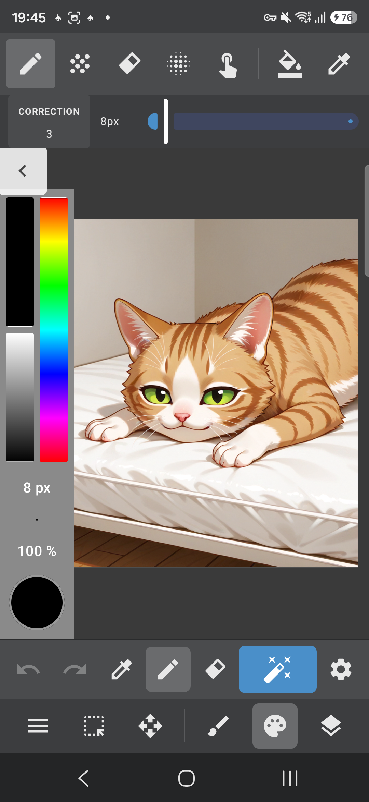
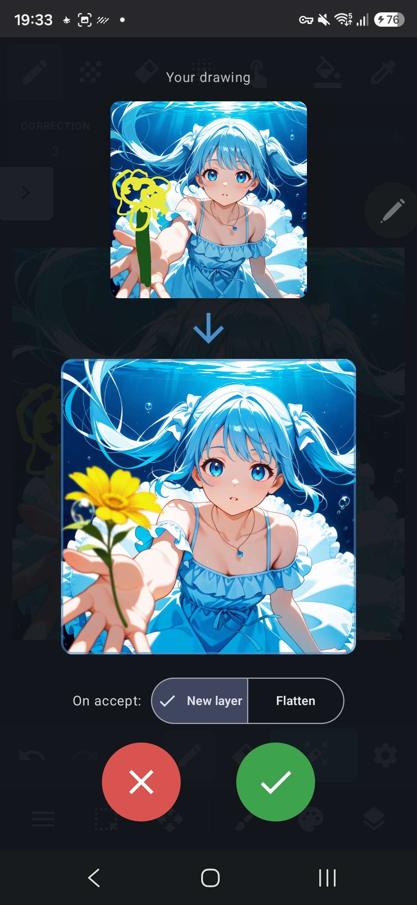

<div align="center">

# Local Dream Canvas

**[Local Dream](https://github.com/xororz/local-dream), with a real drawing canvas.**

&nbsp;&nbsp;


<sub>Left: the canvas. Right: doodle a flower, press the magic button, keep the result.</sub>

</div>

This is an unofficial fork of [xororz/local-dream](https://github.com/xororz/local-dream).
The generation engine and the models are the upstream ones; the canvas, for
drawing and painting together with the AI, is the reason to use this fork. A few
smaller extras are listed further down. Don't care about the canvas? The fork
works as a regular Local Dream too: skip the canvas and enjoy the extras.

Upstream Local Dream only lets you scribble on top of an image you picked for
img2img. Here the canvas is a full drawing screen, with its tools laid out like
MediBang Paint.

## What's different

**Canvas mode**
- Opens from the new **Canvas** button next to img2img. With no image picked it
  starts blank at your output resolution and aspect ratio; with an image it
  becomes the base layer.
- Layers: add, duplicate, merge down, reorder, hide, opacity, rename, import an
  image as a layer.
- Brushes: pen, airbrush, eraser, blur and smudge, with adjustable size,
  opacity, hardness, spacing and strength. Press the size or opacity value next
  to the color panel and drag up or down to change it. Bucket fill.
- Eyedropper: picks a color and goes back to the tool you were using. Holding a
  finger or the pen still on a drawing tool also picks a color, and a magnifier
  with a crosshair shows the exact pixel above your finger (both can be turned
  off in Settings).
- S Pen: pressure (size and/or opacity), the eraser end erases, hover shows the
  brush outline, adjustable stabilizer. Optional "only the pen draws" mode.
- Inpaint mask brush: paint (or erase) the area the AI should redraw, shown in red.
- Selections: rectangle, lasso and magic wand (new / add / subtract), with cut,
  copy, paste as a layer, clear, and move/scale/rotate.
- Gestures: pinch to zoom and pan, twist two fingers to rotate the canvas (snaps
  to quarter turns; Fit resets it), two-finger tap undoes, three-finger tap redoes.
- Projects (`.ldcanvas`: layers plus prompt and settings) are saved separately
  from the generation history: Save, Save as, Save and quit, Open.
- Export to the gallery, optionally keeping transparency (no paper color behind
  the layers).

**The magic button**
- The blue button in the bottom bar generates from your drawing:
  - drawing, no selection: img2img
  - drawing with an inpaint mask: inpaint, only the red area is regenerated
    (a selection is just a selection; turn it into a mask with
    Selection → Use as inpaint mask)
  - empty canvas: txt2img

  The button shows which mode it will run (TXT2IMG / IMG2IMG / INPAINT).
- Batch count works too: you get several results and tap the one to keep.
- Your drawing and the result are shown together. ✓ keeps the result (as a new
  layer or flattened, your choice), ✗ throws it away. The prompt and settings
  stay, so you can keep drawing on top and run it again.
- The gear button holds the prompt, negative prompt, denoise strength and batch
  count, plus the usual steps / CFG / seed / sampler. It can also load a prompt
  from the Local Dream history or from a PNG, which helps when you switch models.

## Differences from vanilla Local Dream (besides the canvas)

Small extras in the app underneath, same engine and models as upstream:

- **Prompt in saved PNGs**, in the A1111 `parameters` format (Civitai, ComfyUI
  and most viewers read it). On by default; turn it off for plain images.
- **Background saving fix**: images that finish while the app is minimized or
  the screen is locked are saved (upstream drops them). Careful with batches in
  your pocket: the phone can get very hot, unless you wanted a pocket heater.
- **Backup & Restore carries more**: also canvas projects and settings. Turn on
  "Compatible with original Local Dream" to export the history only, in the
  upstream format.
- **Installs next to the original app** (package `io.github.denius.localdreamcanvas`).
  The local backend port is a setting (default 8081, like upstream); if the
  original app is running too, set **Settings → Local backend port** to
  something else, e.g. 8091.
- **Portuguese, Spanish and Russian** translations for the whole app (on top of
  upstream's Japanese, Korean and Chinese).
- A **Local Dream Canvas Options** section at the top of Settings, holding the
  options this fork adds.
- A **Check for updates of this fork** button (Settings → Local Dream Canvas
  Options) that opens the latest release page on GitHub.
- No NSFW filter build: only the `basic` flavor exists.

## Install

Grab the APK from the [Releases](https://github.com/denius72/local-dream-canvas/releases) page. Requirements are the same as upstream Local Dream
(see below). If you already use Local Dream with models in `Download/LocalDream`,
set **Model storage → Downloads** in this app and grant "All files access"; it
will use the same models without downloading them again.

## Import & export (moving to and from the original Local Dream)

Both apps install side by side and keep separate history. Move your images
between them with **Settings → Backup & Restore**, which works in both apps and
uses the same zip format.

**From the original Local Dream to Local Dream Canvas**
1. In Local Dream: **Settings → Backup & Restore → Export** (all images, or
   favorites only).
2. In Local Dream Canvas: **Settings → Backup & Restore → Import** and pick that
   zip.

**From Local Dream Canvas back to the original**
1. In Local Dream Canvas: **Settings → Backup & Restore**, turn on **Compatible
   with original Local Dream**, then **Export**. This writes the history only, in
   the upstream layout (`LocalDream_history_*.zip`).
2. In Local Dream: **Settings → Backup & Restore → Import**.

A normal backup with that switch off (`LocalDreamCanvas_backup_*.zip`) also
imports in the original app. You get the history and the canvas data is carried
along unused, so use the compatible export when the zip is only for the original.

**What moves and what stays**
- History (images, prompts, parameters, favorites) moves both ways.
- Canvas projects and canvas settings exist only in this app. A normal backup
  keeps them, so use it to move them to a new phone or reinstall. The compatible
  export leaves them out.
- Models are not part of a backup. Point both apps at the same folder (see
  *Install*) and they share one copy.
- Import merges, it never replaces. An image that is already there (same model,
  same timestamp) is skipped, so going back and forth and importing the same
  zip twice is safe.
- Images from models you don't have installed still import. Find them with
  the history filter set to *All models*.

To bring a single image's prompt into the canvas, without a full backup, use
**Load prompt from Local Dream history** or **Load prompt from a PNG image** in
the canvas generation settings (gear button). The PNG option needs an image
saved by this app or another A1111-style tool. The original Local Dream does
not write the prompt into its PNGs.

## Building

The native backend is not built by Gradle. As in upstream, `app/src/main/jniLibs`
and the QNN libraries are not in git. The quickest way to get them is from the
official upstream APK of the matching version (the one *without* `_with_filter`):

- `lib/arm64-v8a/libstable_diffusion_core.so` and `libdit_engine.so` go to
  `app/src/main/jniLibs/arm64-v8a/`
- `assets/qnnlibs/`, `assets/ditlibs/` and `assets/licenses/qnn-*` go to the same
  paths under `app/src/main/`

Then:

```sh
./gradlew :app:assembleBasicDebug
```

Release builds read `RELEASE_STORE_FILE`, `RELEASE_STORE_PASSWORD`,
`RELEASE_KEY_ALIAS` and `RELEASE_KEY_PASSWORD` as Gradle properties.

## Credits & license

All the hard work (NPU inference, model conversion, the app itself) is
[xororz](https://github.com/xororz)'s and the Local Dream contributors'. Please
support the original project.

Same license as upstream:
[CC BY-NC 4.0](LICENSE). Attribution is required and commercial use is not allowed.

Not affiliated with Local Dream or MediBang.

---

<details>
<summary><b>Original Local Dream README</b></summary>

<div align="center">

# Local Dream 

**Android Stable Diffusion with Snapdragon NPU acceleration**  
_Also supports CPU/GPU inference_


</div>

## About this Repo

This project is **now open sourced and completely free**. Hope you enjoy it!

If you like it, please consider [sponsor](#-support-this-project) this project.

> [!NOTE]
> Currently focused on SD1.5 and SDXL models. SD2.1 is no longer maintained due to poor quality and limited popularity.
>
> **NPU support:**
>
> - SD1.5 models are supported on Snapdragon NPUs with Hexagon V68 architecture or newer.
> - SDXL models are supported on Snapdragon 8 Gen 3 and newer devices.
>
> CPU/GPU inference supports SD1.5 and imported SDXL MNN packages. Large SDXL
> models require substantially more memory than SD1.5.
>
> You can join our [telegram group](https://t.me/local_dream) for discussion or help with testing.

## User Guide

For certain reasons, all guides and documentation have been moved to [Guide Site](https://ld-guide.chino.icu).

## Credits & Acknowledgments

Local Dream is built on top of many excellent open-source projects. Sincere thanks to all the authors and contributors whose work made this project possible.

### C++ Libraries

- **[Qualcomm QNN SDK](https://www.qualcomm.com/developer/software/qualcomm-ai-engine-direct-sdk)** - NPU model execution
- **[alibaba/MNN](https://github.com/alibaba/MNN/)** - CPU model execution
- **[happyyzy/stable-diffusion.cpp](https://github.com/happyyzy/stable-diffusion.cpp)** - Deep performance optimizations for on-device DiT inference
- **[xtensor-stack](https://github.com/xtensor-stack)** - Tensor operations & scheduling
- **[mlc-ai/tokenizers-cpp](https://github.com/mlc-ai/tokenizers-cpp)** - Text tokenization
- **[yhirose/cpp-httplib](https://github.com/yhirose/cpp-httplib)** - HTTP server
- **[nothings/stb](https://github.com/nothings/stb)** - Image processing
- **[facebook/zstd](https://github.com/facebook/zstd)** - Model compression
- **[nlohmann/json](https://github.com/nlohmann/json)** - JSON processing

### Android Libraries

- **[square/okhttp](https://github.com/square/okhttp)** - HTTP client
- **[coil-kt/coil](https://github.com/coil-kt/coil)** - Image loading & processing
- **[MoyuruAizawa/Cropify](https://github.com/MoyuruAizawa/Cropify)** - Image cropping
- **AOSP, Material Design, Jetpack Compose** - UI framework

### Models

- **[CompVis/stable-diffusion](https://github.com/CompVis/stable-diffusion)** and all other model creators
- **[xinntao/Real-ESRGAN](https://github.com/xinntao/Real-ESRGAN)** - Image upscaling
- **[Kim2091/UltraSharpV2](https://huggingface.co/Kim2091/UltraSharpV2)** - Image upscaling
- **[bhky/opennsfw2](https://github.com/bhky/opennsfw2)** - NSFW content filtering

---

## 💖 Support This Project

If you find Local Dream useful, please consider supporting its development:

### What Your Support Helps With:

- **Additional Models** - More AI model integrations
- **New Features** - Enhanced functionality and capabilities
- **Bug Fixes** - Continuous improvement and maintenance

<a href="https://ko-fi.com/xororz">
    
</a>
<a href="https://afdian.com/a/xororz">
    
</a>

Your sponsorship helps maintain and improve Local Dream for everyone!

</details>
